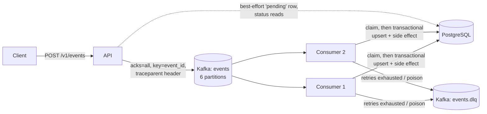

# Relay

A fault-tolerant event-processing pipeline in Go. An HTTP API publishes events to Kafka, a consumer
group applies them to PostgreSQL with idempotent effects, and failures are retried, dead-lettered and
observable end to end.

**Go · Apache Kafka (KRaft) · PostgreSQL · Prometheus · OpenTelemetry · Docker Compose · Kubernetes (kind) · GitHub Actions**

## Highlights

- **At-least-once delivery, effectively-once effects.** Offsets are committed only after the PostgreSQL
  transaction commits, and a conditional upsert on `event_id` makes redeliveries no-ops.
- **Parallel across partitions, ordered within one**, with rebalances that never skip or double-commit a record.
- **Failure-aware retries.** Permanent errors dead-letter immediately, transient ones back off with jitter,
  and outages wait without dead-lettering healthy events.
- **Observable.** Prometheus metrics including consumer lag, end-to-end traces, JSON logs, a Grafana dashboard.
- **Operable.** Graceful shutdown, liveness and readiness probes, Kubernetes manifests with KEDA autoscaling.

## Architecture



## Quick start

```bash
make up                                   # Kafka, PostgreSQL, API, 2 consumers, Prometheus, Jaeger, Grafana
NOW=$(date -u +%Y-%m-%dT%H:%M:%SZ)
curl -s -X POST localhost:8080/v1/events -H 'Content-Type: application/json' -d '{
  "event_id": "evt_123", "event_type": "order.created", "occurred_at": "'"$NOW"'",
  "payload": {"order_id": "order_456", "amount": 1299}}'

curl -s localhost:8080/v1/events/evt_123  # {"status":"processed","attempts":1,...}
curl -s localhost:8080/v1/stats           # side effect: count and amount per event type
```

Grafana <http://localhost:3000>, Jaeger <http://localhost:16686>, Prometheus <http://localhost:9090>.
`make reset` wipes all data.

## Development

```bash
make test          # go vet + unit tests with -race (no Docker needed)
make lint          # golangci-lint v2
make integration   # real Kafka + PostgreSQL
make bench         # load generator
```

## Documentation

See [docs/DOCS.md](docs/DOCS.md) for the API contract, how the consumer works, failure behaviour,
benchmarks, configuration and limitations.
