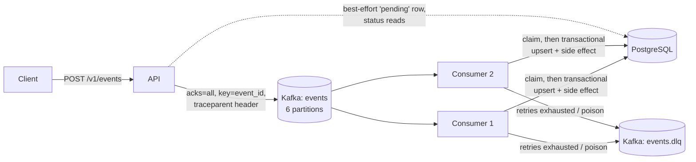

# Relay documentation

Detail behind the [README](../README.md): the API contract, how the pipeline behaves under failure,
measured performance and configuration.

## Contents

- [Architecture](#architecture)
- [API](#api)
- [How it works](#how-it-works)
- [Failure behaviour](#failure-behaviour)
- [Benchmarks](#benchmarks)
- [Development and configuration](#development-and-configuration)
- [Limitations](#limitations)

## Architecture



The API and the consumer are separate binaries and deployments. The API needs only Kafka to accept
writes; consumers need Kafka and PostgreSQL.

## API

| Endpoint | Behaviour |
| --- | --- |
| `POST /v1/events` | Validates the event and assigns `event_id` if missing. `202` only after Kafka acknowledges (`acks=all`). `400`/`413`/`415` for bad input, `503` when Kafka is down or the server is overloaded; a 503 carries the `event_id` so the client can retry with it. |
| `GET /v1/events/{id}` | `pending` → `processing` → `processed` \| `failed`, plus `attempts` and `last_error`. Eventually consistent with Kafka. |
| `GET /v1/stats` | Per-type event count and amount total (the business side effect). |
| `GET /healthz`, `/readyz`, `/metrics` | Liveness, readiness (Kafka is critical; PostgreSQL is reported but not required for ingestion), Prometheus. |

Validation is strict: no unknown fields or trailing data, 64 KiB body limit, lowercase dotted
`event_type`, RFC 3339 `occurred_at` (≤ 5 min in the future), and a JSON-object payload that PostgreSQL
`jsonb` can store (no `\u0000`, no unpaired surrogates). `amount`, if present, is an integer in `[0, 10¹²]`.
The consumer re-validates every record, because anything can be produced to the topic directly.

## How it works

### Consume loop

`PollRecords` (rebalances blocked) → partitions in parallel, records in order →
`CommitRecords` for the last _completed_ record per partition → `SetOffsets` to rewind partitions that
stopped early → `AllowRebalance`. A record counts as completed only after its database transaction commits
or Kafka acknowledges its dead letter.

Rebalances are blocked while a batch is in flight. When one is pending, workers yield after their current
record and unfinished partitions are rewound, so a record is never skipped or committed twice.

### Idempotency

`INSERT … ON CONFLICT (event_id) DO UPDATE … WHERE status <> 'processed'` and the side
effect (`event_stats` upsert) run in one transaction; zero affected rows means a duplicate. Concurrent
duplicates during a rebalance serialise on the row lock and the loser sees the committed status.

### Retries and dead letters

Exponential backoff with equal jitter (100 ms → 5 s), up to 5 attempts for
transient errors. Outages retry without consuming that budget, so lag grows instead of the DLQ. Dead
letters keep the original key, value and headers and add `x-dlq-reason`, `x-dlq-attempts` and `x-origin-*`.

### Replaying dead letters

Replays must be bounded and keep the key. Piping a live tail of `events.dlq` back into
`events` loops forever on records that are still invalid, and dropping the key moves records to another
partition. Dump once, select what was fixed, produce with keys:

```bash
docker compose exec -T kafka /opt/kafka/bin/kafka-console-consumer.sh --bootstrap-server kafka:9092 \
  --topic events.dlq --from-beginning --timeout-ms 5000 --property print.key=true --property key.separator='|' > dlq.txt
grep '^evt_123|' dlq.txt | docker compose exec -T kafka /opt/kafka/bin/kafka-console-producer.sh \
  --bootstrap-server kafka:9092 --topic events --property parse.key=true --property key.separator='|'
```

Already-processed events are skipped by the idempotency guard, so a replay never double-applies.

### Shutdown

The API fails readiness, drains, stops the HTTP server and flushes the producer. The
consumer finishes in-flight records (transactions are never cancelled halfway), commits, and leaves the
group so its partitions move immediately instead of after the session timeout.

## Failure behaviour

| Scenario | What happens | Verified by |
| --- | --- | --- |
| Crash after DB commit, before offset commit | Redelivered, detected as a duplicate, no double effect | `TestRedeliveryIsIdempotent` |
| PostgreSQL down | API keeps accepting; consumers retry as _unavailable_, lag grows, no dead letters, full catch-up | outage drill: 12 retries, 0 dead letters; lag 120 → 0 |
| An event keeps failing | 5 jittered attempts, then `events.dlq` with reason; status `failed` | unit tests, `TestFailuresAreDeadLettered`, `FAULT_RATE=1` drill |
| Poison record produced straight to Kafka | Dead-lettered on the first attempt; the partition keeps flowing | drill |
| Rebalance (scale up / graceful leave) | Yield after in-flight records, commit, rewind the rest; only moved partitions are revoked | `TestRebalanceAndShutdownLoseNothing` (600/600 exactly once) and a manual drill |

## Benchmarks

Measured with `cmd/loadgen` on one 8-vCPU VM running the whole Compose stack (Kafka, PostgreSQL, API, two
consumers, observability and the load generator share the CPUs). Single broker, 6 partitions, `acks=all`,
~256 B payloads, `WORKERS=4` per consumer. End-to-end latency is `processed_at - occurred_at`, computed in
PostgreSQL.

| Scenario | Result |
| --- | --- |
| Ingest only (64 clients, consumers stopped) | ~10,750 accepted/s, HTTP p50 5.7 ms |
| Steady ~925 events/s for 30 s | end-to-end p50 19.5 ms, p95 29 ms, p99 37 ms |
| Steady ~1,850 events/s for 30 s | end-to-end p50 86 ms, p95 142 ms, p99 175 ms; consumers keep up |
| Drain a ~148k backlog, 1 consumer | 1,416 events/s |

Two measured optimisations:

- **Per-partition fetch size.** With franz-go's default (1 MiB per partition) a poll is often a single
  partition and three of four workers idle. Capping it at 64 KiB raised single-consumer drain throughput
  from **694 to 1,416 events/s**.
- **Asynchronous commit for best-effort writes.** The API's only database write is the `pending` row,
  which is safe to lose, so its pool runs with `synchronous_commit=off`: **~6,700 → ~10,750 accepted/s**,
  HTTP p50 8.9 → 5.7 ms. The consumer's writes stay fully durable.

Numbers are from a development VM, not a production claim. Reproduce with `make bench`.

## Development and configuration

Common tasks:

```bash
make test          # go vet + unit tests with -race (no Docker needed)
make lint          # golangci-lint v2
make integration   # real Kafka + PostgreSQL: HTTP→DB, redelivery, DLQ, rebalance + shutdown
make bench         # RATE=1000 DURATION=30s by default
make kind-up kind-deploy   # local Kubernetes: API on localhost:30080
```

### CI and configuration

CI runs lint and manifest validation (kubeconform), race-enabled unit tests, the integration suite and an
image build. Configuration comes from the environment (`KAFKA_BROKERS`, `DATABASE_URL`, `WORKERS`,
`MAX_ATTEMPTS`, `RETRY_BASE_DELAY`/`RETRY_MAX_DELAY`, `KAFKA_SESSION_TIMEOUT`, `PUBLISH_TIMEOUT`,
`MAX_IN_FLIGHT`, `OTEL_EXPORTER_OTLP_ENDPOINT`, `FAULT_RATE`, …); invalid values fail start-up with every
problem listed.

## Limitations

A single Kafka broker and a single PostgreSQL instance locally, not a highly available cluster.
Processing is effectively-once only for database effects; external side effects would need their own
idempotency keys. Retries happen in place, which preserves order but blocks the partition while it waits.
The per-type counters are deliberately simple hot rows.
